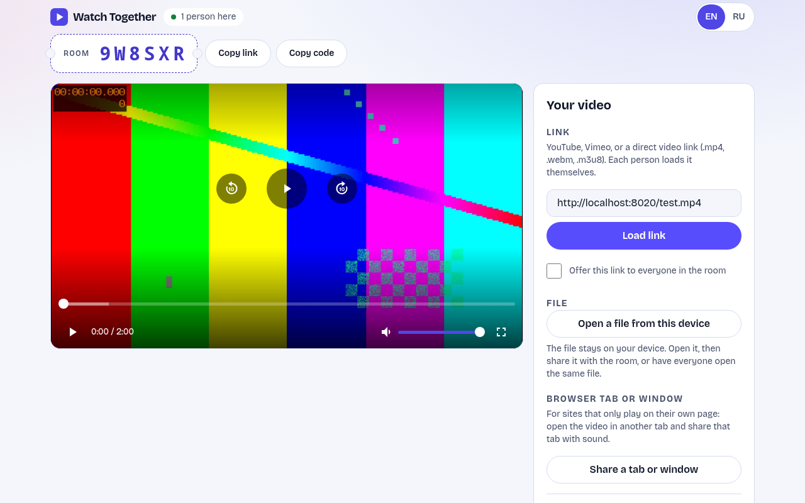
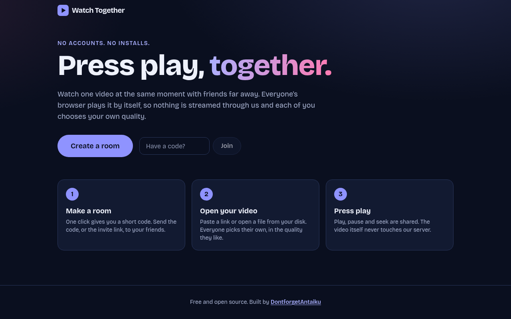
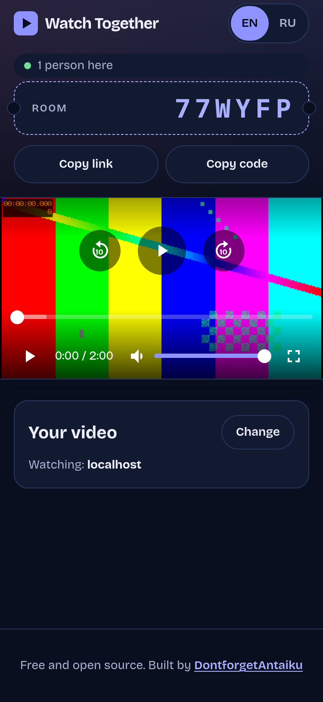
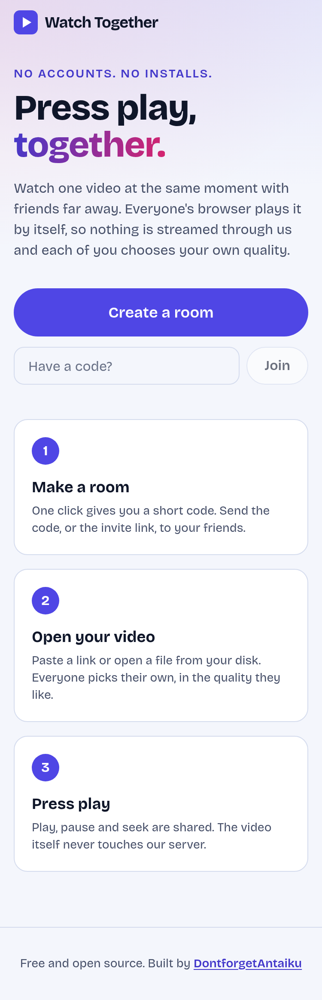

<div align="center">

# Watch Together

**Press play, together.**

Open a page, get a short room code, share it. Everyone's browser plays the video by itself,
and the server only passes tiny play, pause and seek messages.

Free · Open source · No account · No install · English and Russian · Mobile friendly



</div>

---

## How it works

1. **Create a room.** One click gives you a 6-character code (`K7M2QX`) and an invite link.
2. **Get a video to everyone**, whichever way suits you:
   - **Each opens the same thing themselves**: paste a YouTube or Vimeo link, a direct video link (`.mp4`, `.webm`, `.m3u8`), or open a file from your own disk.
   - **Share your file**: friends watch it straight from your browser, no copy needed.
   - **Share a browser tab or window** (with sound): for sites that only play on their own page.
3. **Press play.** Play, pause and seek are shared by everyone. Late joiners catch up on their own.

The server never carries video. It keeps one tiny state per room (`playing`, `position`, `time it was valid`),
forwards changes, and relays the few messages two browsers need to find each other.
A single small VPS can host thousands of rooms.

<div align="center">

&nbsp;

&nbsp;

</div>

## Features

- **Rooms without accounts** — short code or invite link; rooms live in memory and disappear 30 minutes after the last person leaves.
- **Four ways to watch together**
  - **Platform links** through each site's official embedded player, kept in sync through its API: **YouTube**, **Vimeo**, **Twitch videos** and **Streamable**.
    Twitch live streams and clips are embedded too, but they have no playhead to control, so everyone just watches.
  - **Direct links** — `.mp4`, `.webm` and **HLS** (`.m3u8`, via [hls.js](https://github.com/video-dev/hls.js), loaded only when needed; Safari and recent Chrome play HLS natively).
  - **Share your file (peer to peer)** — the file is played in your browser and streamed to friends over WebRTC. Everyone can pause and seek; your player obeys.
  - **Share a tab or window (peer to peer)** — with sound, as a live stream.
- **Tight sync** — all clocks are aligned to the server; tiny drift is smoothed with a ±5 % speed nudge, big drift is fixed with a seek. Typical error is well under 100 ms on a good connection.
- **A real player** — one big play button, ±10 s buttons, seek bar with buffered range, volume, full screen, auto-hiding controls,
  double-tap to skip on touch screens, and keyboard shortcuts (below).
- **Your own quality** — a gear menu in the player: every viewer of a shared file or tab picks 1080p / 720p / 480p / 360p / Auto for their own stream, and HLS links offer their quality ladder.
- **One share at a time** — when someone starts sharing a file or a tab, everyone (including a previous sharer) switches to it automatically. No confirmation, no flip-flopping.
- **Self-healing connection** — the server pings every 15 s; a silent connection (phone asleep, network change) is replaced automatically, so no page refresh is needed.
- **Same-file check** — when everyone opens their own copy, the room compares lengths and warns if they differ by more than a second (a different cut would drift out of sync).
- **Late join** — a person who joins while the video plays lands on the right second.
- **Offer a link** — optionally offer your link to the room; others get a one-click "Use it" button.
- **Phone-first layout** — pinned player while you scroll, big touch targets, safe-area aware, landscape mode that fits the screen,
  the system **Share** sheet for invites, and a source panel that tucks away once a video is loaded.
- **English and Russian** — follows the browser language, switch any time; easy to add more (see below).
- **Light and dark theme** — follows the system.
- **Private by design** — no analytics, no cookies, no accounts, no CDN fonts. Third parties are contacted only when you use them:
  YouTube or Vimeo for their links, and a STUN server (Google's by default) for peer-to-peer sharing. See [Privacy](#privacy).
- **Tiny backend** — FastAPI, one process, no database, no Redis.

### Keyboard shortcuts

| Key | Action |
|---|---|
| `Space` / `K` | Play / pause |
| `←` / `→` | Back / forward 5 s (`Shift`: 10 s) |
| `J` / `L` | Back / forward 10 s |
| `↑` / `↓` | Volume |
| `M` | Mute |
| `F` | Full screen |
| `0` | Back to the start |

## Which links work

The browser itself downloads the video, so the host has to allow it:

| Source | Works when |
|---|---|
| YouTube, Vimeo, Twitch videos, Streamable | The video allows embedding (most do). Twitch plays ads inside the embed for viewers who are not logged in; while an ad runs, that person can briefly be out of sync. |
| Twitch live streams and clips | Embedded, but not synchronized (nothing to sync). |
| Direct file (`.mp4`, `.webm`) | The host allows playback from other sites (most do). |
| HLS (`.m3u8`) | Safari / recent Chrome: usually yes. Other browsers need the host to send CORS headers (`Access-Control-Allow-Origin`). |
| Local file | Always. Either share it with the room, or everyone opens the **same cut**, or positions will not match. |
| Any site that only plays on its own page | Open it in another tab and **share that tab** (with sound). |

Things that commonly break a link: it **expired** (many CDN links carry a time-limited token), it is **bound to the IP** of whoever copied it,
the host blocks other websites, or the page is `https` and the link is plain `http` (the browser refuses mixed content).
Many streaming sites do exactly this on purpose: their video only plays on their own page, and no other site can embed it.
For those, share the browser tab, or download the video and share the file. The app tells you which kind of failure it saw.

> Only use videos you are allowed to watch and share. This tool does not download, store or re-stream anything.

## Quick start

Requirements: Node.js 24 (LTS), Python 3.13+ and [uv](https://docs.astral.sh/uv/).

```bash
git clone git@github.com:DontforgetAntaiku/watch-together.git
cd watch-together
cp .env.example .env
```

Backend (port 8000):

```bash
cd backend
uv sync
uv run python -m uvicorn main:app --port 8000 --reload
```

Frontend (port 5173, proxies `/api` to the backend):

```bash
cd frontend
npm ci
npm run dev
```

Open <http://localhost:5173>, create a room, then open the invite link in a second browser window.

### Run the tests

```bash
cd backend && uv run python -m pytest -q     # room logic and HTTP API
cd frontend && npm run lint && npm run build  # lint + type-check + production build
```

## Docker

```bash
cp .env.example .env
docker compose up -d --build   # starts the API on 127.0.0.1:${BACKEND_PORT} and builds the site into ./deploy
```

The `frontend-builder` service runs once, copies the static site into `./deploy` and exits (that is normal).
Rebuild only the site with `docker compose run --rm --build frontend-builder`.

| Variable | Default | Meaning |
|---|---|---|
| `BACKEND_PORT` | `8000` | Host port the backend is published on (`127.0.0.1` only) |
| `BACKEND_DEBUG` | `True` | `False` disables `/docs`, `/redoc` and `/openapi.json` |
| `FRONTEND_DEBUG` | `True` | `False` builds the frontend for production |
| `FRONTEND_BUILD_OUTPUT` | `./deploy` | Host folder that receives the built site |
| `RESOLVER_ENABLED` | `false` | Switches the yt-dlp page-link lookup on (see above); more `RESOLVER_*` settings are in `.env.example` |
| `ALLOWED_ORIGINS` | *(empty)* | Comma-separated site origins allowed to call the API. **Set it in production**, e.g. `https://watch.example.com` |
| `MAX_ROOMS` | `5000` | Rooms alive at once |
| `MAX_MEMBERS` | `30` | People per room |
| `EMPTY_ROOM_TTL` | `1800` | Seconds an empty room is kept |
| `CREATE_PER_MINUTE` | `20` | Room creations per IP per minute |
| `HOST_UID` / `HOST_GID` | `1000` | Owner of the generated files |

## Deployment

The frontend is a static site; the backend is one container on `127.0.0.1`. Put any reverse proxy with HTTPS in front:

- Serve the static folder and fall back to `/index.html` for unknown paths (rooms live at `/r/CODE`).
- Proxy `/api/` to `http://127.0.0.1:${BACKEND_PORT}/api/` and pass `X-Real-IP` (used for rate limits).
- **Run a single backend worker**: rooms are kept in the memory of that process.
- No WebSocket configuration is needed: live updates use plain **Server-Sent Events**, so any HTTP proxy works.
  Keep response buffering off for the events route (the backend already sends `X-Accel-Buffering: no`).

```nginx
location /api/ {
    proxy_pass http://127.0.0.1:8000/api/;
    proxy_set_header Host $host;
    proxy_set_header X-Real-IP $remote_addr;
    proxy_set_header X-Forwarded-For $proxy_add_x_forwarded_for;
    proxy_set_header X-Forwarded-Proto $scheme;
}
```

A restart of the backend empties all rooms; clients see "This room does not exist" and can simply create a new one.

## Protocol

Everything is under `/api`:

| Method and path | Purpose |
|---|---|
| `POST /rooms` | Create a room → `{ "code": "K7M2QX" }` (rate limited per IP) |
| `GET /rooms/{code}` | Does it exist, how many people are in it |
| `GET /rooms/{code}/events` | **SSE** stream: `hello` (your id and token), a full `state` on every change, `signal` messages addressed to you, and a `ping` every 15 s |
| `GET /config` | What this server offers (`{ "resolver": false }`) |
| `POST /resolve` | Only when switched on: `{ "url" }` → one direct address (`404` otherwise) |
| `POST /rooms/{code}/msg` | `play` / `pause` / `seek` with `pos`, `ts`; `source` to offer something; `signal` to talk to one member |
| `GET /time` | Server clock, used to align every client |
| `GET /health` | Liveness |

The room state is one snapshot, so it is idempotent and a slow client simply gets the newest one:

```json
{ "t": "state", "playing": true, "pos": 42.5, "at": 1792593246650, "rev": 7, "by": "e9e027b8b0e0", "n": 3,
  "source": { "kind": "yt", "id": "aqz-KE-bpKQ", "by": "e9e027b8b0e0" } }
```

`source` is what the room offers to watch: `link` (a URL), `embed` (a `provider` — `youtube`, `vimeo`, `twitch`, `streamable` — plus a strictly validated `id`), or `p2p` (a name, a duration or `live`, and who is sharing).
`media` is set when people who opened their own copy report lengths that differ by more than a second (`{ lo, hi, n }`).
A `p2p` offer disappears when its owner leaves.

A client computes where the shared playhead is *now* as `pos + (serverNow − at) / 1000` while playing, and `pos` while paused.
The sender stamps its position with its own server-time estimate, which cancels its network delay.

**One share at a time.** The room has a single `source` slot, so the newest `p2p` share replaces the previous one; every client switches to it and a sharer whose share was replaced stops sharing.

**Staying in sync without echo loops.** A player only announces a local action when it *differs* from what the room already
believes, so a player that merely obeyed the room never speaks. Drift is checked once a second: gap above 1.2 s → seek,
above 0.15 s → playback speed 0.95 or 1.05, otherwise 1.0. The same engine drives HTML video, YouTube, Vimeo, Twitch and Streamable through a small adapter; players with quirks (Vimeo and Streamable play by themselves after a seek, Twitch pauses around a seek or an ad) get a guard of their own, never one in the common path.

**Peer-to-peer sharing.** The sharer captures its playing file (`captureStream`) or tab (`getDisplayMedia`). A viewer sends a WebRTC offer to the
sharer through the room's `signal` messages, the sharer answers, and the video then flows directly between the two browsers
(up to 8 viewers per sharer, capped at 4 Mbit/s each; a viewer's quality choice is a `signal` of kind `quality` that scales only that viewer's video). Viewers' play, pause and seek go to the room; the sharer's player obeys, so the stream follows.
The server only relays the offer and answer (size limited, to one named member).

**Abuse limits.** Strict message validation (no unknown fields, finite bounded numbers, `http(s)` links only, fixed shapes for sources),
a token bucket per connection, a cap on rooms and people per room, per-IP room creation limit, origin check, per-member secret token on every message.
There is no personal data: no accounts, no stored IPs beyond a short in-memory rate-limit window.

## Project structure

```
backend/
├── main.py                  app factory, docs switched off when BACKEND_DEBUG=False
├── app/
│   ├── settings.py          environment settings
│   ├── rooms.py             room state, validation, rate limit, broadcast (no I/O)
│   └── routers/rooms.py     HTTP + SSE endpoints
├── tests/                   pytest: room logic and API
└── Dockerfile               python:3.14-slim
frontend/
├── src/
│   ├── components/          Home, Room, Player, VideoPlayer, EmbedPlayer, StreamPlayer, Controls, SourcePanel, … (each: Name/Name.tsx + Name.css)
│   ├── i18n/                i18next setup and locales/{en,ru}.json
│   ├── lib/useRoom.ts       SSE connection and message sending
│   ├── lib/engine.ts        the sync engine (one player ↔ the room's playhead)
│   ├── lib/adapters.ts      HTML video, YouTube and Vimeo behind one interface
│   ├── lib/embedAdapters.ts Twitch, Streamable (player.js protocol) and the provider factory
│   ├── lib/embed.ts         recognising platform links
│   ├── lib/audioMix.ts      one outgoing audio track that sound inputs can join later
│   ├── lib/p2p.ts           WebRTC sharer and viewer
│   ├── lib/clock.ts         server clock estimate and playhead maths
│   ├── lib/attach.ts        links → <video>, hls.js on demand, friendly errors
│   └── index.css            design tokens (light/dark) and shared controls
└── Dockerfile               node:24-alpine build, copy-only final stage
docker-compose.yml           backend + frontend-builder
docs/                        screenshots used in this README
```

**Stack:** Vite · React 19 · TypeScript · Tailwind CSS v4 · react-i18next · hls.js · @vimeo/player · FastAPI · uvicorn.

## Limits and ideas

- **Sharing a file** needs a browser that can capture a playing `<video>` (Chrome, Edge, Firefox; not Safari). Android phones are supported through a canvas fallback, but it is the least tested path; a computer is more reliable. Viewers can be on any device. Phone recordings (HEVC/H.265) may not play on every computer.
  Quality depends on the sharer's upload speed. Strict networks or VPNs may block a direct connection; add a TURN server (below) if that happens to you.
- **Sharing a tab** works in Chrome and Edge (with tab sound) and Firefox (video only: Firefox cannot share sound, and on Linux/Wayland it never can), on computers. Play and pause in the shared tab itself; viewers just watch.
- Playback speed is not synced (the speed is used internally to nudge small drifts).
- If someone's video buffers for a long time, the others keep playing; that person catches up with a seek.
- **Platforms that cannot be added:** Dailymotion (its player API needs a partner player ID), PeerTube (its player library is AGPL-3.0, which would change this project's license), and every DRM service (Netflix, Disney+ …), which no website can play or share.
  VK Video and Rutube are not included. No chat, no subtitles sync. Pull requests are welcome.

### Sound from the whole system (why a browser can't, and what to do)

Discord is a native app and can capture the operating system's audio. A website only gets what the browser's share dialog hands over:

| Browser / system | Tab sound | Whole-system sound |
|---|---|---|
| Chrome / Edge, any OS | yes ("Also share tab audio") | Windows only: choose **Entire screen** and tick **Share system audio** |
| Chrome / Edge on Linux or macOS | yes | no |
| Firefox | **never** | no |
| Wayland (any browser) | no, the screen-share portal carries no audio | no |

The app works around it: while sharing a tab or window, **Add sound from a device** mixes any sound input into the share, without reconnecting anyone.
On Linux (PulseAudio or PipeWire) pick the input named **Monitor of …**: that is everything you hear. Allow microphone access once so the browser shows the device names;
the app only uses it to reach the device you pick, and turns echo cancellation and noise suppression off so music and film sound stay clean.
On macOS install a virtual audio device (BlackHole, Loopback) and pick it the same way.

### Your own STUN / TURN servers

Peer-to-peer sharing uses `stun:stun.l.google.com:19302` by default to find each side's public address. To use your own servers (a TURN server relays
the video when a direct connection is impossible), build the frontend with:

```bash
VITE_ICE_SERVERS='[{"urls":"turn:turn.example.com:3478","username":"user","credential":"secret"}]' npm run build
```

Credentials in a frontend build are public, so use short-lived TURN credentials.

## Optional: resolve a page link (yt-dlp)

Off by default. When the owner switches it on, a **Resolve a page link** button appears under the link field. The server runs
[yt-dlp](https://github.com/yt-dlp/yt-dlp) to find the video behind a page address and sends back **one direct address**;
every browser then plays it by itself. The video never goes through the server, only the lookup does.

What it helps with: sites that expose a plain `.mp4` or an HLS stream that is not tied to anyone's address (tested with Streamable and Dailymotion, up to 1080p).
What it does not help with, and why:

- **Links tied to the server's address** (YouTube and many others): your friends' browsers have other addresses, so the host refuses them.
- **Links locked to the original site** (many streaming sites): the host checks which site is asking, and no other site can ask.
- **Separate picture and sound streams** (the best YouTube quality): a browser cannot play two addresses as one video, so such pages are reported as unsupported.
- **Logins, private videos, sites yt-dlp has no extractor for** are reported with a clear message.
- Links **expire**, often within hours.

Turn it on in `.env` with `RESOLVER_ENABLED=true`, then restart the backend (`docker compose up -d --build`). The image always contains yt-dlp; the feature stays off until that flag is set.
Sites change often, so rebuild with `--no-cache` now and then to get a current yt-dlp. If the flag is on but yt-dlp is missing (an old image), the button stays hidden and the backend log says so.
The settings are listed in `.env.example`. Please read this before enabling it:

- The server fetches addresses chosen by visitors, so it is a request-forgery target. Built in: only `http(s)` on ports 80 and 443, no credentials, no `localhost` / `.local` / `.internal` names, every address a name points to must be public, yt-dlp runs with an
  empty environment and a timeout, at most a few lookups run at once (the rest wait or are refused), results are cached, and each visitor is rate limited.
- What that cannot fully stop: a site that redirects to an internal address, or a name that changes its answer between our check and yt-dlp's own lookup.
  **Run the backend where it cannot reach anything private.** A Docker container can usually still reach the host and the local network. Point `RESOLVER_PROXY` at an egress proxy that refuses private ranges, or block it with firewall rules.
- Set `RESOLVER_ALLOWED_HOSTS` to a short list of sites if you only need a few. Empty means any public site.
- It sends requests to other sites from your server's address, which may get that address rate limited or blocked, and some sites' terms forbid automated access. You decide whether that is acceptable.

## Adding a language

1. Copy [`frontend/src/i18n/locales/en.json`](frontend/src/i18n/locales/en.json) to `xx.json` and translate every value (keep the keys;
   plural keys end in `_one`, `_few`, `_many`, `_other` as the language needs).
2. In [`frontend/src/i18n/index.ts`](frontend/src/i18n/index.ts) import the file, add it to `resources`, `supportedLngs` and `LANGUAGES`.

## Privacy

No analytics, no cookies, no accounts, no personal data on the server. Files you open are read locally and never uploaded.
Things worth knowing:

- Using a **YouTube**, **Vimeo**, **Twitch** or **Streamable** link loads their player, which talks to them (YouTube through its privacy-enhanced domain, Vimeo with tracking off). The page sends no referrer, except that Streamable's player gets this site's address, which it needs to answer.
- **Peer-to-peer sharing** asks a STUN server for your public address, and the people in the room who watch your share connect directly to your IP address.
  Only share with people you trust.
- The room code is the only secret. Anyone who has it can join, so don't post it publicly.

## Contributing

Issues and pull requests are welcome. Please run `uv run python -m pytest` in `backend/` and `npm run lint && npm run build`
in `frontend/` before opening a PR.

## License

[MIT](LICENSE) © 2026 DontforgetAntaiku

## Credits

Built by [DontforgetAntaiku](https://dontforgetantaiku.dev/).
